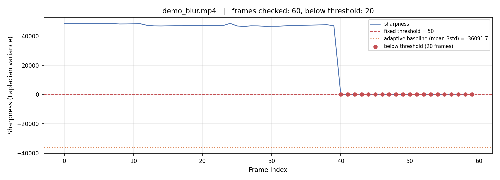

# 🎥 Ego Video Quality Inspector · Ego 视频质检流水线


**一句话**：面向具身智能第一视角（Egocentric）数据的自动化视频质检工具——逐帧量化清晰度、自动标记模糊帧、产出结构化质检报告，把小时级的人工抽检压缩到分钟级。

---

## 📌 背景与动机

具身智能（Embodied AI）模型的训练高度依赖第一视角采集的真实交互数据。但在采集现场：

- 设备晃动、对焦失败、遮挡、运动模糊……坏帧混在数小时的视频里；
- 人工抽检效率低：1 小时 30fps 的视频 ≈ 108,000 帧，肉眼根本看不过来；
- 更关键的是**不可追溯**：人工看过的结论无法沉淀成可统计的数据资产。

本工具把「抽帧 → 清晰度评估 → 模糊判定 → 报告产出」整条链路自动化，质检结果落成 CSV：可统计、可回溯、可接入下游数据 Pipeline。

## ✨ 核心功能

| 功能 | 说明 |
| --- | --- |
| 逐帧清晰度量化 | 拉普拉斯方差法（Laplacian Variance），单帧毫秒级 |
| 模糊帧自动标记 | 阈值可调（默认 50），低于阈值判定为模糊 |
| 单视频 / 目录批量 | `--input` 既接受单个视频，也接受整个采集文件夹（`--recursive` 递归搜索） |
| 抽帧快检 | `--frame-step N` 每 N 帧检一帧，长视频先粗筛再精查 |
| 三层质检报告 | 逐帧明细 / 模糊帧清单 / 每视频汇总统计 |
| 模糊帧归档 | `--save-blur-frames` 将疑似模糊帧按视频归档，供人工二次复核 |
| 健壮性 | 无法打开的视频自动跳过并记录；解码帧数 < 元数据帧数时告警（疑似损坏文件）；出错时退出码非 0，方便接入调度脚本 |
| 实时进度 | tqdm 进度条 + 实时模糊计数 |
| 趋势可视化 | `plot_quality_curve.py` 将报告绘制为清晰度趋势图：模糊帧标红 + 叠加自适应基线（均值 − 3σ） |

## ⚙️ 工作原理

对每一帧：

1. BGR → 灰度图；
2. 拉普拉斯算子（二阶导数）卷积，突出边缘等高频信息；
3. 取响应的**方差**作为清晰度分数——清晰图像边缘丰富、响应波动大、方差高；模糊图像高频被抹平、方差趋近 0。

```text
sharpness = Var(Laplacian(Gray(frame)))
```

> ⚠️ 该分数是**相对量**：与分辨率、镜头、内容纹理强相关，跨视频直接比大小没有意义。建议对同一采集配置先建立基线，再设定阈值（见 Roadmap：自适应阈值）。

## 🚀 快速开始

### 环境要求

- Python 3.8+
- 依赖见 `requirements.txt`：opencv-python / numpy / pandas / tqdm

```bash
git clone https://github.com/<你的用户名>/ego-video-quality-inspector.git
cd ego-video-quality-inspector
pip install -r requirements.txt

# ① 生成演示视频：一段全程清晰 + 一段后半段失焦（程序化生成，无需任何真实数据）
python make_demo_video.py

# ② 批量质检演示数据，并归档模糊帧
python video_quality_inspector.py --input demo_data --recursive --save-blur-frames

# ③ 绘制清晰度趋势图（模糊帧标红 + 自适应基线）
python plot_quality_curve.py --csv qc_output/quality_report.csv
```

Windows + Anaconda 用户（推荐绝对路径调用解释器，规避中文安装路径导致的终端问题）：

```bat
E:\Robotics\Anaconda3\python.exe video_quality_inspector.py --input test.mp4
```

### 参数说明

| 参数 | 默认值 | 说明 |
| --- | --- | --- |
| `--input, -i` | （必填） | 视频文件或文件夹路径 |
| `--recursive, -r` | 关闭 | 输入为文件夹时递归搜索子目录 |
| `--blur-threshold, -t` | 50 | 清晰度阈值，低于该值判定为模糊 |
| `--frame-step, -s` | 1 | 每 N 帧检测一帧（1 = 逐帧全检） |
| `--output-dir, -o` | `qc_output` | 报告与图片输出目录 |
| `--save-frames` | 关闭 | 保存全部抽帧图片到 `frames/<视频名>/` |
| `--save-blur-frames` | 关闭 | 归档模糊帧图片到 `blur_frames/<视频名>/` |
| `--verbose, -v` | 关闭 | 输出 DEBUG 级日志（含逐帧模糊告警） |

## 📊 输出示例

对演示数据执行批量质检（`demo_sharp.mp4` 全程清晰，`demo_blur.mp4` 第 40 帧起程序化失焦）：

```text
            video  frames_read  frames_checked  blur_count  blur_ratio_pct  sharpness_mean  sharpness_min  sharpness_max
   demo_blur.mp4           60              60          20           33.33        31665.32          1.33       48623.84
  demo_sharp.mp4           60              60           0            0.00        47006.55      41158.21       48623.84
```

输出文件结构：

| 文件 | 内容 |
| --- | --- |
| `qc_output/quality_report.csv` | 逐帧明细：`video, frame_name, frame_idx, sharpness, is_blur` |
| `qc_output/blur_frames.csv` | 仅模糊帧清单（无模糊帧时不生成） |
| `qc_output/summary_report.csv` | 每视频汇总：读取帧数 / 实测帧数 / 模糊数 / 模糊率 / 清晰度均值·极值 |
| `qc_output/blur_frames/<视频名>/` | 模糊帧图片（需 `--save-blur-frames`） |
| `qc_output/frames/<视频名>/` | 全部抽帧图片（需 `--save-frames`） |

演示数据中失焦帧的清晰度分数从 4 万量级坍缩到 1.3 左右，与清晰帧分离度超过 4 个数量级，验证了该方法在此场景下的区分能力。

## 📈 效果图

对演示视频 `demo_blur.mp4`（第 40 帧起失焦）运行 `plot_quality_curve.py`：



红色实心点为低于固定阈值的帧，橙色点线为「均值 − 3σ」自适应基线。注意一个有意思的细节：当清晰度呈"清晰段 + 失焦段"的双峰分布时，全局 mean − 3σ 会被两个峰同时稀释而失真（示例中基线被压成负值）——这正是 Roadmap 中将自适应基线升级为**滑动窗口基线**的原因。

## 🗂 项目结构

```
ego-video-quality-inspector/
├── video_quality_inspector.py   # 主脚本：批量质检 CLI
├── plot_quality_curve.py        # 可视化：清晰度趋势图（模糊帧标红 + 自适应基线）
├── make_demo_video.py           # 演示数据生成器（可复现的"已知答案"测试）
├── requirements.txt
├── .gitignore                   # 数据文件一律不入库
├── docs/
│   └── quality_curve_demo.png   # 效果图（由演示数据生成）
└── archive/                     # 开发历程存档（Day1 原型 → v3 的迭代记录）
```

## 🔒 数据合规

本仓库**不包含任何真实业务采集数据**：所有演示视频均由 `make_demo_video.py` 程序化生成；`.gitignore` 默认屏蔽 `*.mp4`、`frames/`、`*.csv` 等数据文件，防止真实数据被误提交。

## 🧭 Roadmap

- [ ] 自适应阈值：以正常段均值 − 3σ（或分位数）为动态基线，替代固定阈值
- [ ] 冻结帧（定帧）检测：基于相邻帧差分，补充"画面卡死"这一质检维度
- [ ] 多进程并行：支撑日级百段视频的吞吐
- [ ] HTML 可视化报告：清晰度趋势曲线 + 模糊帧缩略图墙

## 📜 License

MIT
